<p align="center">
  
</p>

<h1 align="center">CardVault</h1>

<p align="center"><b>Your cards, privately held.</b></p>

<p align="center">
  
</p>

CardVault is a Flutter app for keeping your debit and credit cards, benefits, spending, subscriptions, loans, documents and emergency contacts in one encrypted vault on your own device. Cards sit in a signature layered deck and take on colours that resemble the real bank products. Everything is stored locally, works fully offline and needs no account.

It is not a banking app. It never connects to a bank, never fetches data online and has no credit-score features. Every figure is entered by you and calculated on the device.

## Features

- **Layered card deck**: vertical swipe with spring physics, tap to select, tap the selected card to flip it, long-press for quick actions, expand to a full list, and drag to reorder (only in reorder mode, so swipe and drag never clash). Haptics on every interaction.
- **Real-bank card styles**: 15 issuers and 48 product palettes (HDFC, ICICI, SBI, Axis, Kotak, IDFC FIRST, Bank of Baroda, PNB, Canara, Union, IndusInd, AU, Federal, Yes, American Express) with textures, chip, contactless and network marks. Custom banks and custom colours are supported. Styles resemble real products and are never presented as official artwork.
- **Card vault**: add, edit, archive, block and delete cards, favourites, travel and daily-use stacks, your own collections (each with its own deck), search, filter and sort.
- **Benefits**: lounge visits, cashback, waivers and more, with usage counters, validity dates and reminders. Nothing is fetched online.
- **Calendar and reminders**: expiry, billing, due, annual-fee, benefit, subscription and EMI dates, with local notifications you can time and repeat.
- **Money tools**: transactions, spending analytics, payment planner, financial overview, subscriptions, loans with repayment schedules, goals, and a side-by-side card comparison that never recommends a card.
- **Calculators**: personal, home, car and card-EMI, simple and compound interest, prepayment savings and a full amortization schedule, in rupees with Indian digit grouping.
- **Documents**: an encrypted vault for PDFs and images with in-memory preview and secure delete.
- **Emergency centre**: a card-blocking checklist and your own bank contacts, clearly labelled as user-entered.
- **Insights**: charts for banks, networks, card status, monthly spend and categories, all computed locally.
- **Backup and restore**: export an encrypted `.cvbackup` file and restore it on a new device from the first screen.
- **Responsive**: a floating bottom bar on phones, a side rail with two-pane layouts on tablet, desktop and web.

### Offline and security

| Protection | How it works |
| --- | --- |
| 100% offline | No backend, Firebase, analytics or network calls. The release Android manifest has no `INTERNET` permission, iOS has no ATS exceptions, and fonts and images are bundled. A test fails the build if networking code or packages appear. |
| Encrypted at rest | Android and iOS use a SQLCipher (AES-256) database. Windows and web use one AES-256-GCM sealed blob. Documents are individually AES-256-GCM encrypted in app-private storage. |
| Keys never hard-coded | A random 256-bit vault key is created at setup and stored only wrapped, under your master password (PBKDF2-HMAC-SHA256) and under a one-time recovery code. Biometric unlock keeps a copy in the iOS Keychain or Android Keystore. There is no password reset that bypasses encryption. |
| No secrets stored | There is no field for CVV, ATM PIN, OTP or banking passwords anywhere, and a unit test asserts it. Card numbers are masked and need re-authentication to reveal. |
| Hardened UX | Auto-lock with a timeout, back-off after failed attempts, content cover in the app switcher, Android `FLAG_SECURE`, clipboard cleared after 30 seconds, nothing sensitive in logs, secure delete of files. |
| Encrypted backup | A `.cvbackup` file protected by a password you choose. Your master password and recovery code are never part of it. |

Encryption protects data at rest. It cannot protect a device that is already compromised (malware, root or jailbreak).

### Moving to a new device

1. Open **Security, Backup and restore** (or the cloud icon in Card Vault) and choose **Export encrypted backup**.
2. Copy the `.cvbackup` file to the new device. It is useless without its password.
3. On the new device's first screen choose **Restore from a backup**, enter the backup password and set a new master password. Cards, documents and settings come back as they were.

The dashboard reminds you when your last backup is older than 30 days.

## Screenshots

Thumbnails link to the full-size images in [`docs/screenshots`](docs/screenshots). They are rendered from the real app by `test/screenshots_test.dart`, with the sample data from **Settings, Load sample data**.

<table>
  <tr>
    <td align="center"><a href="docs/screenshots/mobile-welcome.png">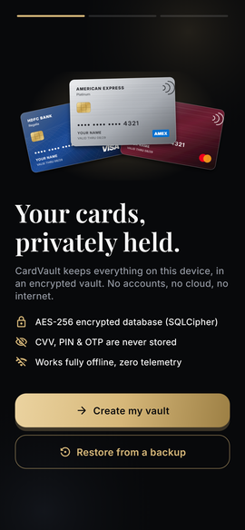</a><br><sub>Welcome</sub></td>
    <td align="center"><a href="docs/screenshots/mobile-home.png"></a><br><sub>Dashboard</sub></td>
    <td align="center"><a href="docs/screenshots/mobile-card-deck.png"></a><br><sub>Card deck</sub></td>
    <td align="center"><a href="docs/screenshots/mobile-deck-expanded.png">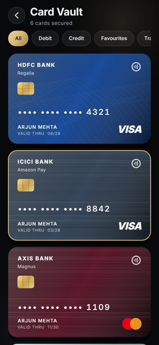</a><br><sub>Expanded deck</sub></td>
    <td align="center"><a href="docs/screenshots/mobile-card-details.png"></a><br><sub>Card details</sub></td>
  </tr>
  <tr>
    <td align="center"><a href="docs/screenshots/mobile-card-back.png">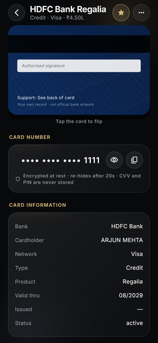</a><br><sub>Card flip</sub></td>
    <td align="center"><a href="docs/screenshots/mobile-add-card.png">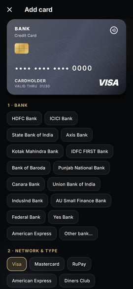</a><br><sub>Add card</sub></td>
    <td align="center"><a href="docs/screenshots/mobile-collections.png"></a><br><sub>Collections</sub></td>
    <td align="center"><a href="docs/screenshots/mobile-benefits.png">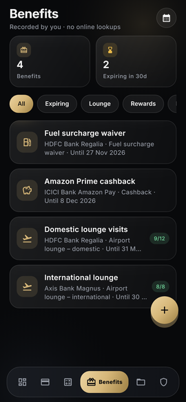</a><br><sub>Benefits</sub></td>
    <td align="center"><a href="docs/screenshots/mobile-benefit-details.png">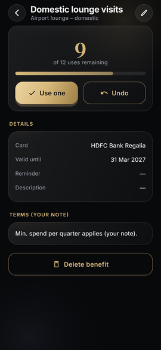</a><br><sub>Benefit details</sub></td>
  </tr>
  <tr>
    <td align="center"><a href="docs/screenshots/mobile-calendar.png"></a><br><sub>Calendar</sub></td>
    <td align="center"><a href="docs/screenshots/mobile-spending.png"></a><br><sub>Spending</sub></td>
    <td align="center"><a href="docs/screenshots/mobile-insights.png">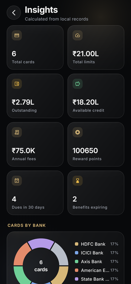</a><br><sub>Insights</sub></td>
    <td align="center"><a href="docs/screenshots/mobile-payments.png"></a><br><sub>Payment planner</sub></td>
    <td align="center"><a href="docs/screenshots/mobile-calculators.png"></a><br><sub>Calculators</sub></td>
  </tr>
  <tr>
    <td align="center"><a href="docs/screenshots/mobile-documents.png"></a><br><sub>Documents</sub></td>
    <td align="center"><a href="docs/screenshots/mobile-security.png"></a><br><sub>Security</sub></td>
    <td align="center"><a href="docs/screenshots/mobile-backup-restore.png">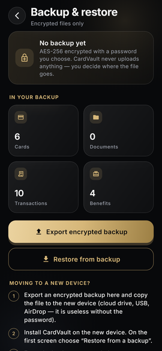</a><br><sub>Backup &amp; restore</sub></td>
    <td align="center"><a href="docs/screenshots/mobile-emergency.png">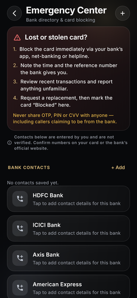</a><br><sub>Emergency</sub></td>
    <td align="center"><a href="docs/screenshots/mobile-compare.png">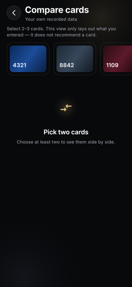</a><br><sub>Compare cards</sub></td>
  </tr>
</table>

**Tablet and desktop**

<table>
  <tr>
    <td align="center"><a href="docs/screenshots/tablet-home.png"></a><br><sub>Tablet: dashboard</sub></td>
    <td align="center"><a href="docs/screenshots/tablet-card-vault.png">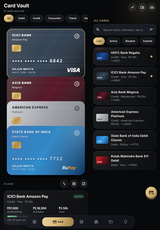</a><br><sub>Tablet: card vault</sub></td>
    <td align="center"><a href="docs/screenshots/desktop-home.png">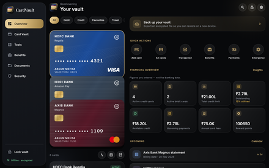</a><br><sub>Desktop: dashboard</sub></td>
  </tr>
  <tr>
    <td align="center"><a href="docs/screenshots/desktop-card-vault.png">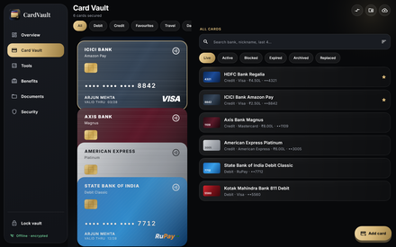</a><br><sub>Desktop: card vault</sub></td>
    <td align="center"><a href="docs/screenshots/desktop-calculators.png">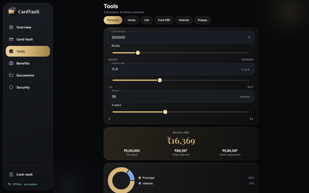</a><br><sub>Desktop: calculators</sub></td>
    <td align="center"><a href="docs/screenshots/desktop-spending.png">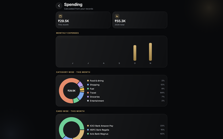</a><br><sub>Desktop: spending</sub></td>
  </tr>
  <tr>
    <td align="center"><a href="docs/screenshots/desktop-benefits.png">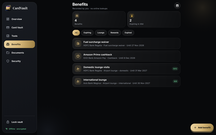</a><br><sub>Desktop: benefits</sub></td>
    <td align="center"><a href="docs/screenshots/desktop-backup-restore.png">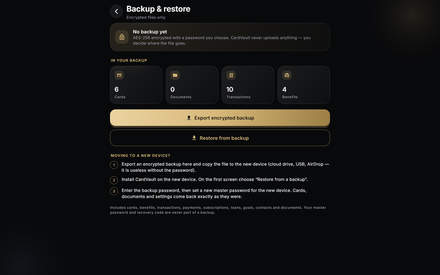</a><br><sub>Desktop: backup &amp; restore</sub></td>
    <td align="center"><a href="docs/screenshots/desktop-security.png">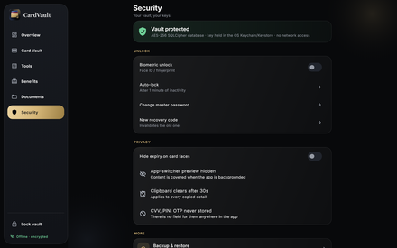</a><br><sub>Desktop: security</sub></td>
  </tr>
</table>

### Promo images

<p align="center">
  <a href="docs/thumbnails/cardvault-thumb-2-devices.png">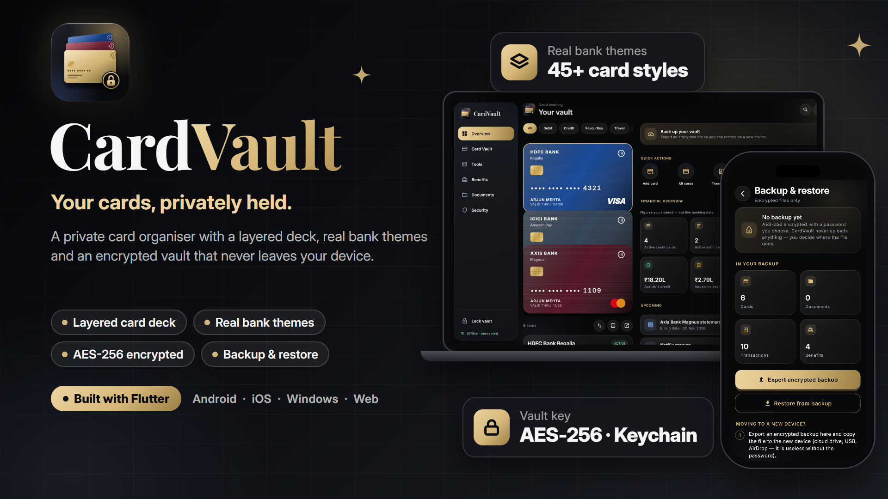</a>
  <a href="docs/thumbnails/cardvault-thumb-3-gallery.png">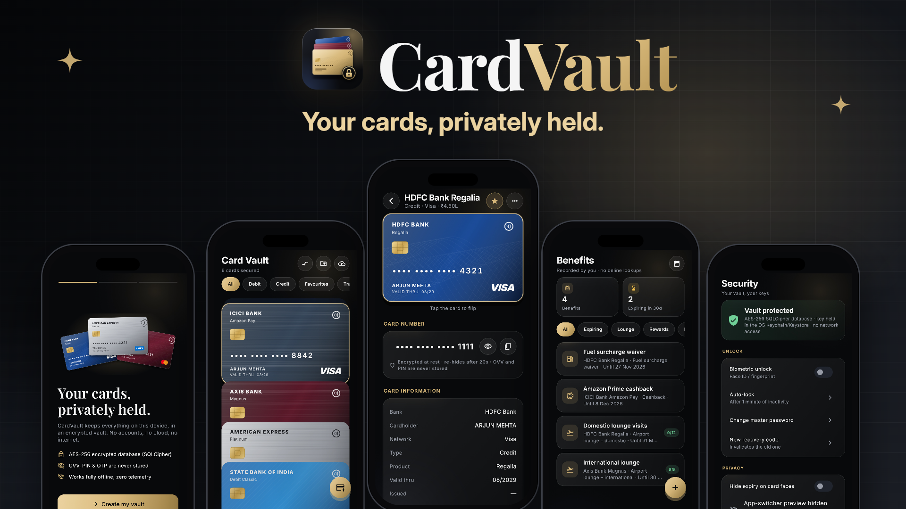</a>
</p>

## Tech stack

- Flutter and Dart (SDK 3.13 or newer), Riverpod for state
- `sqflite_sqlcipher` for the encrypted database on Android and iOS
- `cryptography` (AES-256-GCM, PBKDF2) and `flutter_secure_storage` (iOS Keychain, Android Keystore) for keys
- `local_auth` for biometrics, `flutter_local_notifications` and `timezone` for local reminders
- `file_picker`, `path_provider` and `pdfx` for documents and backups
- `fl_chart` and `flutter_animate` for charts and motion
- Inter and Playfair Display are bundled, so no font is ever downloaded

## Project structure

```
lib/
  main.dart
  core/      no widgets in here
    theme/     design tokens, ThemeData, page transitions
    models/    entities (CardItem, Benefit, Txn ...) and the real-bank card styles
    data/      RecordStore (SQLCipher, encrypted blob, memory) and the Riverpod repository
    security/  crypto, vault service (keys, throttling, biometrics), session / auth controller
    services/  notifications, documents, backup, sample data
    utils/     finance maths, validators, formatters
  ui/
    app.dart, app_guard.dart, gate.dart   MaterialApp, auto-lock and privacy cover, splash / setup / lock gate
    routes/    navigation helpers
    screens/   one folder per feature: splash, setup, lock, shell, overview, cards, collections,
               benefits, calendar, money, tools, documents, directory, insights, security
    widgets/   reusable pieces: common (glass, buttons, nav, responsive), cards (face, deck), forms,
               charts, overview, brand
assets/brand/    logo (SVG and 512x512 PNG), named logo, full-bleed icon master, horizontal wordmark
assets/images/   in-app illustrations
docs/            screenshots/ (+ thumbs/) and thumbnails/ (promo images)
tool/            make_logo.py, make_art.py (+ brand_svg.py), capture_screenshots.py, make_thumbnails.py, barrels.py
test/            unit, offline, backup and screenshot-journey tests
```

`core/core.dart`, `ui/widgets/widgets.dart` and `ui/screens/screens.dart` are barrel files; regenerate them with `python tool/barrels.py` after adding or removing a file.

## Getting started

```bash
flutter pub get
flutter run                 # Android or iOS device / emulator
flutter run -d windows      # desktop
flutter run -d chrome       # web
```

- Android: accept the SDK licences once with `flutter doctor --android-licenses`.
- iOS: needs a Mac with Xcode. Run `cd ios && pod install` first. The Face ID usage text is already set.
- To explore with data, open **Settings, Load sample data**.

Run the checks:

```bash
flutter analyze
flutter test        # unit, security, offline, backup and UI-polish tests, plus 3 UI journeys
```

## Regenerating the images

The logo, screenshots and promo images are all generated by scripts (Python with Playwright and Pillow, plus the Flutter test runner):

```bash
python tool/make_logo.py                     # logo + launcher icons (Android, iOS, web, Windows)
python tool/make_art.py                      # in-app illustrations (hero cards, empty state, shield), vector -> PNG
python tool/capture_screenshots.py           # docs/screenshots + docs/screenshots/thumbs
python tool/make_thumbnails.py               # docs/thumbnails (1920x1080 promo images)
```

## Known gaps

- SQLCipher, biometrics and scheduled notifications have been verified in tests and on desktop, but not yet on physical Android and iOS devices. Android and iOS builds have not been produced from this machine.
- Windows and web have no SQLCipher; they use an AES-256-GCM encrypted blob instead, and web storage is limited by the browser quota (about 5 MB).
- Only plain-text documents are indexed for search; for PDFs and images you add searchable text yourself.
- Dragging a card in reorder mode does not auto-scroll the page at the screen edges.
- The app is dark only; there is no light theme.
