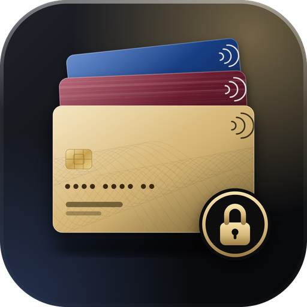
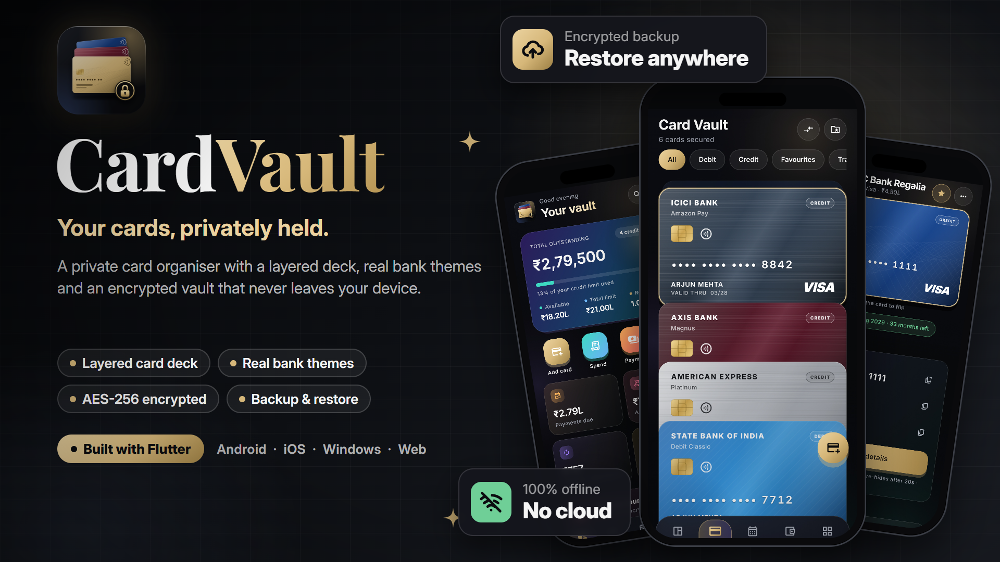
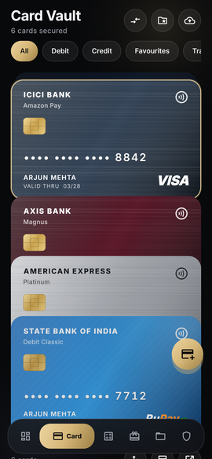
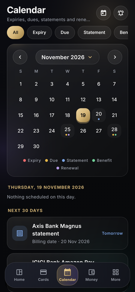
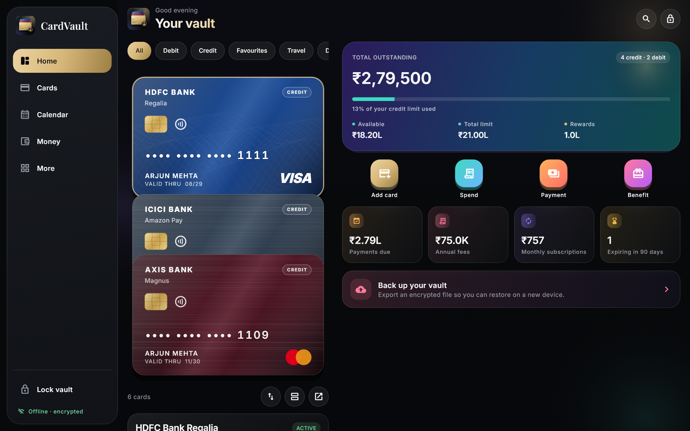

<p align="center">
  
</p>

<h1 align="center">CardVault</h1>

<p align="center"><b>Your cards, privately held.</b></p>

<p align="center">
  
  
  
  
  
  
</p>

<p align="center">
  
</p>

CardVault is a Flutter app for keeping your debit and credit cards, card secrets, benefits, spending, subscriptions, loans, documents and bank contacts in one encrypted vault on your own phone. It runs on **Android and iOS**, and also on Windows and the web. Cards sit in a layered deck and use colour styles that resemble the real bank products. Everything is stored on the device, works fully offline and needs no account.

It is not a banking app. It never connects to a bank, never fetches data online and has no credit-score features. Every figure is entered by you and calculated on the device.

## Contents

- [Features](#features)
- [Security and privacy](#security-and-privacy)
- [Screenshots](#screenshots)
- [Getting started](#getting-started)
- [Moving to a new device](#moving-to-a-new-device)
- [Tech stack](#tech-stack)

## Features

### Cards

- **Layered card deck**: swipe vertically with spring physics, tap to select, tap again to flip, long-press for quick actions, expand to a list, and drag to reorder in reorder mode.
- **Full card record**: bank, network, credit or debit, holder, nickname, 16-digit card number (formatted and capped at 16 digits, checked with Luhn), expiry, **CVV**, **card PIN**, limits, statement and due days, fees, reward points and notes.
- **Extra details**: add any number of labelled fields per card, such as CRN, customer ID, account number, IFSC or net-banking user ID. Mark any of them as secret to mask it.
- **Protected reveal**: the number, CVV, PIN and secret extras stay masked until you confirm with Face ID, fingerprint or your master password. They hide again after 20 seconds, and anything you copy is cleared from the clipboard after 30 seconds.
- **Card styles**: 16 Indian issuers, including **Bank of India**, HDFC, ICICI, SBI, Axis, Kotak and American Express, with 52 bank-inspired styles, 10 signature gradients (Aurora, Sunset, Ocean, Cosmic, Rose Gold and more) and custom colour pairs. Faces have a chip, contactless and network marks, a credit or debit badge and a back with signature and CVV panels. The CVV is always masked on the card art. Styles resemble real products and are never presented as official artwork.
- **Organise**: favourites, travel and daily-use stacks, your own collections, search across names, last 4 and non-secret extras, filters, sort and a side-by-side comparison.

### Dates and money

- **Calendar**: a month grid where you can jump to any month and year from a wheel picker. It marks expiries, payment dues, statements, benefits and renewals, with filters. A **card expiry map** lists every card's expiry with a countdown and a validity bar.
- **Expiry tracking**: cards expiring within 90 days are flagged on the home screen, the card face and the details screen.
- **Date pickers**: every date field uses the same picker, with month and year wheels for quick jumps. Card expiry uses a month and year picker.
- **Money**: transactions, payments, spending analytics, insights, subscriptions, loans with repayment schedules, goals and a net position view.
- **Calculators**: personal, home, car and card-EMI loans, simple and compound interest, prepayment savings and a full amortization schedule, in rupees with Indian digit grouping.
- **Benefits and documents**: lounge visits, cashback and waivers with usage counters, plus an encrypted vault for PDFs and images.
- **Reminders**: local notifications for dues, statements, expiries and renewals. There is no push service.

### Experience

- **Five tabs**: Home, Cards, Calendar, Money and More. Each feature has exactly one entry point, and the **More** hub groups benefits, documents, collections, the bank directory, security, backup, reminders and app data.
- **Home**: a gradient summary of outstanding, available credit, total limit and rewards, four quick actions, cards expiring soon, upcoming dates and a recent-activity timeline grouped by day.
- **Responsive**: a floating five-tab bar on phones, and a side rail with two-pane layouts on tablets, desktop and web. Layouts are checked from 320 px phones to 1440 px desktops, including large system fonts.
- **Keyboard friendly**: drag any form or list to slide the keyboard down, or tap any empty area to close it. Number fields use numeric keypads with Next and Done actions.
- **Motion**: staggered entrances, a sliding tab indicator, 3D card flips, spring presses and haptics.

## Security and privacy

| Protection | How it works |
| --- | --- |
| 100% offline | No backend, Firebase, analytics or network calls. The release Android manifest has no `INTERNET` permission, iOS has no App Transport Security exceptions, and fonts and images are bundled. A test fails the build if networking code or packages appear. |
| Encrypted at rest | Android and iOS use a SQLCipher (AES-256) database. Windows and web use one AES-256-GCM sealed blob. Documents are encrypted one by one with AES-256-GCM in app-private storage. |
| Keys never hard-coded | A random 256-bit vault key is created at setup. It is stored only in wrapped form, under your master password (PBKDF2-HMAC-SHA256) and under a one-time recovery code. Biometric unlock keeps a copy in the iOS Keychain or Android Keystore. No password reset can bypass the encryption. |
| Card secrets | The card number, CVV, PIN and secret extras live only inside the encrypted vault. They are masked everywhere, revealed only after re-authentication, never shown in notifications or the activity log, and a unit test checks this. There is no field for OTPs or banking passwords. |
| Hardened UX | Auto-lock with a timeout, back-off after failed unlock attempts, a content cover in the app switcher, Android `FLAG_SECURE`, the clipboard cleared after 30 seconds, nothing sensitive in logs and secure deletion of files. |
| Encrypted backup | A `.cvbackup` file protected by a password you choose. Your master password and recovery code are never part of it. |

Encryption protects data at rest. It cannot protect a device that is already compromised by malware, rooting or jailbreaking. Keep your OS updated and your phone locked.

## Screenshots

<table>
  <tr>
    <td align="center"><br><sub>Home</sub></td>
    <td align="center"><br><sub>Cards</sub></td>
    <td align="center"><br><sub>Card details</sub></td>
    <td align="center"><br><sub>Calendar</sub></td>
  </tr>
</table>

<p align="center">
  <br><sub>Tablet and desktop layout</sub>
</p>

## Getting started

**Requirements**

| | Version |
| --- | --- |
| Flutter | 3.47 or newer (Dart 3.13 or newer) |
| Android | Android Studio or the command-line SDK; devices on Android 7.0 (API 24) or newer |
| iOS | A Mac with a recent Xcode and CocoaPods; devices on iOS 15 or newer |

```bash
git clone https://github.com/DarkWizardCK-24/CardVault.git
cd CardVault
flutter pub get
flutter run            # picks a connected phone or emulator
```

On first launch, set a master password. CardVault then shows a one-time **recovery code**. Write it down, because it is the only way back in if you forget the password.

## Moving to a new device

1. Open **More → Backup & restore** and choose **Export encrypted backup**.
2. Copy the `.cvbackup` file to the new phone, for example over AirDrop, Files or a cable. The file is useless without its password.
3. On the new phone's first screen, choose **Restore from a backup**, enter the backup password and set a new master password. Cards, card secrets, documents and settings come back as they were.

The home screen reminds you when your last backup is more than 30 days old.

## Tech stack

- Flutter and Dart, with Riverpod for state
- SQLCipher (AES-256) database on Android and iOS
- AES-256-GCM and PBKDF2 encryption, with keys in the iOS Keychain and Android Keystore
- Face ID and fingerprint unlock
- Local notifications for reminders
- Charts and motion with `fl_chart` and `flutter_animate`
