<p align="center">
  
</p>

<h1 align="center">CardVault</h1>

<p align="center"><b>Your cards, privately held.</b></p>

<p align="center">
  
  
  
  
  
  
</p>

<p align="center">
  
</p>

CardVault is a Flutter app for keeping your debit and credit cards, card secrets, benefits, spending, subscriptions, loans, documents and bank contacts in one encrypted vault on your own phone. It runs on **Android and iOS**, and also on Windows and the web. Cards sit in a layered deck and use colour styles that resemble the real bank products. Everything is stored on the device, works fully offline and needs no account.

It is not a banking app. It never connects to a bank, never fetches data online and has no credit-score features. Every figure is entered by you and calculated on the device.

## Contents

- [Features](#features)
- [Security and privacy](#security-and-privacy)
- [Screenshots](#screenshots)
- [Getting started](#getting-started)
- [Running on Android](#running-on-android)
- [Running on iOS](#running-on-ios)
- [Moving to a new device](#moving-to-a-new-device)
- [Project structure](#project-structure)
- [Development](#development)
- [Known gaps](#known-gaps)

## Features

### Cards

- **Layered card deck**: swipe vertically with spring physics, tap to select, tap again to flip, long-press for quick actions, expand to a list, and drag to reorder in reorder mode.
- **Full card record**: bank, network, credit or debit, holder, nickname, 16-digit card number (formatted and capped at 16 digits, checked with Luhn), expiry, **CVV**, **card PIN**, limits, statement and due days, fees, reward points and notes.
- **Extra details**: add any number of labelled fields per card, such as CRN, customer ID, account number, IFSC or net-banking user ID. Mark any of them as secret to mask it.
- **Protected reveal**: the number, CVV, PIN and secret extras stay masked until you confirm with Face ID, fingerprint or your master password. They hide again after 20 seconds, and anything you copy is cleared from the clipboard after 30 seconds.
- **Card styles**: 16 Indian issuers, including **Bank of India**, HDFC, ICICI, SBI, Axis, Kotak and American Express, with 52 bank-inspired styles, 10 signature gradients (Aurora, Sunset, Ocean, Cosmic, Rose Gold and more) and custom colour pairs. Faces have a chip, contactless and network marks, a credit or debit badge and a back with signature and CVV panels. The CVV is always masked on the card art. Styles resemble real products and are never presented as official artwork.
- **Organise**: favourites, travel and daily-use stacks, your own collections, search across names, last 4 and non-secret extras, filters, sort and a side-by-side comparison.

### Dates and money

- **Calendar**: a month grid where you can jump to any month and year from a wheel picker. It marks expiries, payment dues, statements, benefits and renewals, with filters. A **card expiry map** lists every card's expiry with a countdown and a validity bar.
- **Expiry tracking**: cards expiring within 90 days are flagged on the home screen, the card face and the details screen.
- **Date pickers**: every date field uses the same picker, with month and year wheels for quick jumps. Card expiry uses a month and year picker.
- **Money**: transactions, payments, spending analytics, insights, subscriptions, loans with repayment schedules, goals and a net position view.
- **Calculators**: personal, home, car and card-EMI loans, simple and compound interest, prepayment savings and a full amortization schedule, in rupees with Indian digit grouping.
- **Benefits and documents**: lounge visits, cashback and waivers with usage counters, plus an encrypted vault for PDFs and images.
- **Reminders**: local notifications for dues, statements, expiries and renewals. There is no push service.

### Experience

- **Five tabs**: Home, Cards, Calendar, Money and More. Each feature has exactly one entry point, and the **More** hub groups benefits, documents, collections, the bank directory, security, backup, reminders and app data.
- **Home**: a gradient summary of outstanding, available credit, total limit and rewards, four quick actions, cards expiring soon, upcoming dates and a recent-activity timeline grouped by day.
- **Responsive**: a floating five-tab bar on phones, and a side rail with two-pane layouts on tablets, desktop and web. Layouts are checked from 320 px phones to 1440 px desktops, including large system fonts.
- **Keyboard friendly**: drag any form or list to slide the keyboard down, or tap any empty area to close it. Number fields use numeric keypads with Next and Done actions.
- **Motion**: staggered entrances, a sliding tab indicator, 3D card flips, spring presses and haptics.

## Security and privacy

| Protection | How it works |
| --- | --- |
| 100% offline | No backend, Firebase, analytics or network calls. The release Android manifest has no `INTERNET` permission, iOS has no App Transport Security exceptions, and fonts and images are bundled. A test fails the build if networking code or packages appear. |
| Encrypted at rest | Android and iOS use a SQLCipher (AES-256) database. Windows and web use one AES-256-GCM sealed blob. Documents are encrypted one by one with AES-256-GCM in app-private storage. |
| Keys never hard-coded | A random 256-bit vault key is created at setup. It is stored only in wrapped form, under your master password (PBKDF2-HMAC-SHA256) and under a one-time recovery code. Biometric unlock keeps a copy in the iOS Keychain or Android Keystore. No password reset can bypass the encryption. |
| Card secrets | The card number, CVV, PIN and secret extras live only inside the encrypted vault. They are masked everywhere, revealed only after re-authentication, never shown in notifications or the activity log, and a unit test checks this. There is no field for OTPs or banking passwords. |
| Hardened UX | Auto-lock with a timeout, back-off after failed unlock attempts, a content cover in the app switcher, Android `FLAG_SECURE`, the clipboard cleared after 30 seconds, nothing sensitive in logs and secure deletion of files. |
| Encrypted backup | A `.cvbackup` file protected by a password you choose. Your master password and recovery code are never part of it. |

Encryption protects data at rest. It cannot protect a device that is already compromised by malware, rooting or jailbreaking. Keep your OS updated and your phone locked.

## Screenshots

The thumbnails link to full-size images in [`docs/screenshots`](docs/screenshots). They are rendered from the real app by `test/screenshots_test.dart` with illustrative test data. The app itself ships with no sample data.

<table>
  <tr>
    <td align="center"><a href="docs/screenshots/mobile-home.png">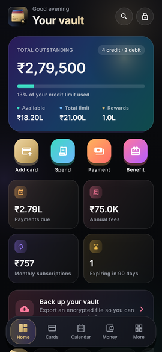</a><br><sub>Home</sub></td>
    <td align="center"><a href="docs/screenshots/mobile-card-deck.png"></a><br><sub>Cards</sub></td>
    <td align="center"><a href="docs/screenshots/mobile-calendar.png"></a><br><sub>Calendar</sub></td>
    <td align="center"><a href="docs/screenshots/mobile-calculators.png">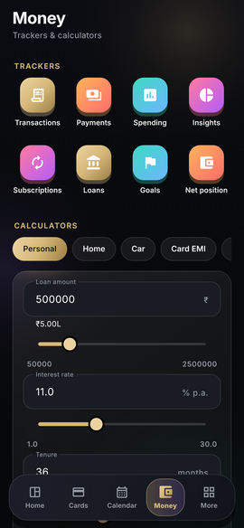</a><br><sub>Money</sub></td>
    <td align="center"><a href="docs/screenshots/mobile-more.png">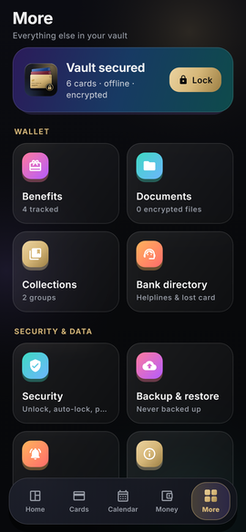</a><br><sub>More</sub></td>
  </tr>
  <tr>
    <td align="center"><a href="docs/screenshots/mobile-card-details.png">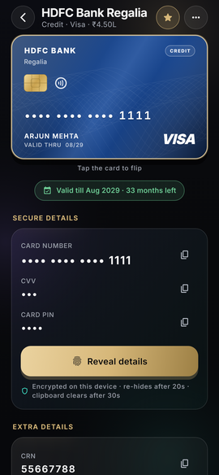</a><br><sub>Card details</sub></td>
    <td align="center"><a href="docs/screenshots/mobile-card-back.png"></a><br><sub>Card back</sub></td>
    <td align="center"><a href="docs/screenshots/mobile-add-card.png"></a><br><sub>Add card</sub></td>
    <td align="center"><a href="docs/screenshots/mobile-deck-expanded.png"></a><br><sub>Expanded deck</sub></td>
    <td align="center"><a href="docs/screenshots/mobile-activity.png">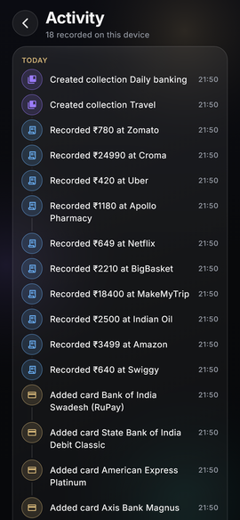</a><br><sub>Activity</sub></td>
  </tr>
  <tr>
    <td align="center"><a href="docs/screenshots/mobile-benefits.png"></a><br><sub>Benefits</sub></td>
    <td align="center"><a href="docs/screenshots/mobile-documents.png">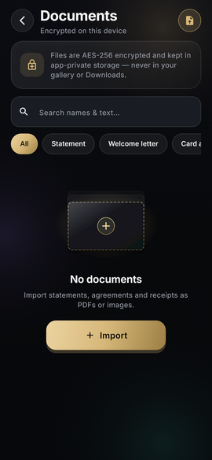</a><br><sub>Documents</sub></td>
    <td align="center"><a href="docs/screenshots/mobile-spending.png">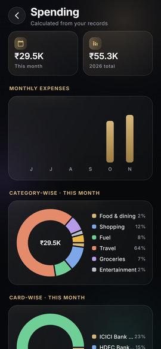</a><br><sub>Spending</sub></td>
    <td align="center"><a href="docs/screenshots/mobile-insights.png"></a><br><sub>Insights</sub></td>
    <td align="center"><a href="docs/screenshots/mobile-payments.png">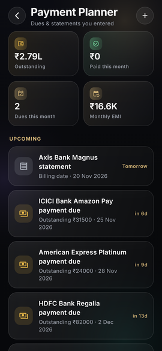</a><br><sub>Payments</sub></td>
  </tr>
  <tr>
    <td align="center"><a href="docs/screenshots/mobile-security.png">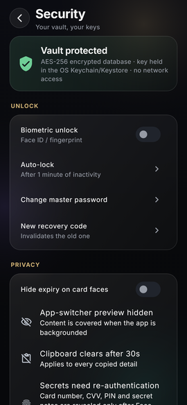</a><br><sub>Security</sub></td>
    <td align="center"><a href="docs/screenshots/mobile-backup-restore.png"></a><br><sub>Backup &amp; restore</sub></td>
    <td align="center"><a href="docs/screenshots/mobile-collections.png">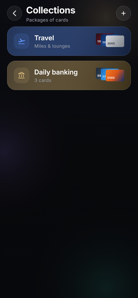</a><br><sub>Collections</sub></td>
    <td align="center"><a href="docs/screenshots/mobile-emergency.png"></a><br><sub>Bank directory</sub></td>
    <td align="center"><a href="docs/screenshots/mobile-locked.png">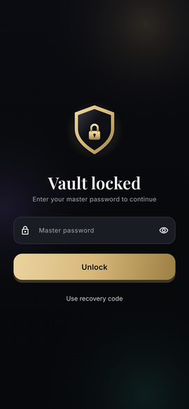</a><br><sub>Lock screen</sub></td>
  </tr>
</table>

**Tablet and desktop**

<table>
  <tr>
    <td align="center"><a href="docs/screenshots/tablet-home.png">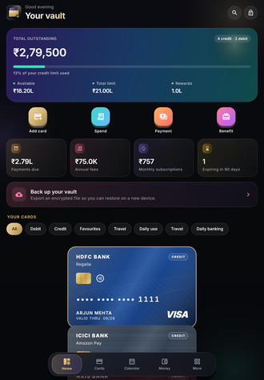</a><br><sub>Tablet: home</sub></td>
    <td align="center"><a href="docs/screenshots/tablet-calendar.png">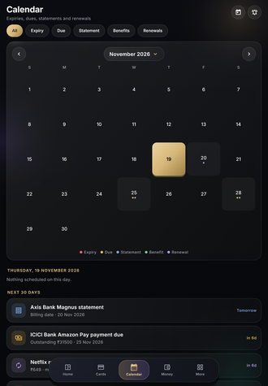</a><br><sub>Tablet: calendar</sub></td>
    <td align="center"><a href="docs/screenshots/desktop-home.png"></a><br><sub>Desktop: home</sub></td>
  </tr>
  <tr>
    <td align="center"><a href="docs/screenshots/desktop-card-vault.png"></a><br><sub>Desktop: cards</sub></td>
    <td align="center"><a href="docs/screenshots/desktop-calculators.png"></a><br><sub>Desktop: money</sub></td>
    <td align="center"><a href="docs/screenshots/desktop-insights.png">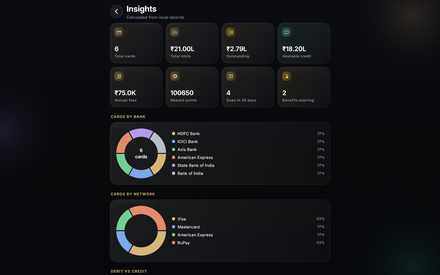</a><br><sub>Desktop: insights</sub></td>
  </tr>
</table>

<p align="center">
  <a href="docs/thumbnails/cardvault-thumb-2-devices.png"></a>
  <a href="docs/thumbnails/cardvault-thumb-3-gallery.png"></a>
</p>

## Getting started

**Requirements**

| | Version |
| --- | --- |
| Flutter | 3.47 or newer (Dart 3.13 or newer) |
| Android | Android Studio or the command-line SDK; devices on Android 7.0 (API 24) or newer |
| iOS | A Mac with a recent Xcode and CocoaPods; devices on iOS 15 or newer |

```bash
git clone https://github.com/DarkWizardCK-24/CardVault.git
cd CardVault
flutter pub get
flutter run            # picks a connected phone or emulator
```

On first launch, set a master password. CardVault then shows a one-time **recovery code**. Write it down, because it is the only way back in if you forget the password.

## Running on Android

1. Accept the SDK licences once:
   ```bash
   flutter doctor --android-licenses
   ```
2. On the phone, turn on **Developer options** and **USB debugging**, connect it by cable and accept the debugging prompt.
3. Run:
   ```bash
   flutter devices                # the phone should be listed
   flutter run                    # debug build with hot reload
   flutter run --release          # fast build that also works without the cable
   ```
4. To build an installable file:
   ```bash
   flutter build apk --release        # build/app/outputs/flutter-apk/app-release.apk
   flutter build appbundle --release  # for the Play Store
   ```

**Notes**

- The package name is `com.cardvaultt.app`, and the project compiles against SDK 37.
- Fingerprint unlock needs at least one fingerprint enrolled on the phone.
- Reminders use exact alarms, and Android 13 or newer asks for notification permission the first time you turn reminders on.
- Before publishing, sign release builds with your own keystore. `key.properties` and `*.jks` are git-ignored.

## Running on iOS

You can run CardVault on your own iPhone without TestFlight. A free Apple ID works.

1. Install the tools on a Mac:
   ```bash
   brew install cocoapods
   sudo xcodebuild -runFirstLaunch
   flutter doctor                 # Xcode should show no errors
   ```
2. Install the pods and open the workspace:
   ```bash
   flutter pub get
   cd ios && pod install && cd ..
   open ios/Runner.xcworkspace    # the .xcworkspace, not the .xcodeproj
   ```
3. In Xcode, set up signing under **Runner → Signing & Capabilities**:
   - Tick **Automatically manage signing** and pick your **Team**. A Personal Team is fine.
   - If `com.cardvaultt.app` is unavailable for your team, change the bundle identifier to something unique.
4. On the iPhone, tap **Trust This Computer**, then turn on **Settings → Privacy & Security → Developer Mode**. The phone restarts.
5. Run:
   ```bash
   flutter run                    # debug: hot reload and logs, needs the Mac connected
   flutter run --release          # opens from the home screen without the Mac
   ```
6. The first time the app opens, iOS asks you to trust the developer. Go to **Settings → General → VPN & Device Management**, select your Apple ID and tap **Trust**.

**Notes**

- The project is already set up for iOS:
  - the Podfile targets iOS 15 for the app and every pod
  - the Face ID and photo-library messages are set
  - notifications show while the app is open
  - the launch screen is dark
  - there are no App Transport Security exceptions
- With a free Apple ID, the install lasts **7 days**. Running it again from Xcode or `flutter run` renews it and keeps your data. A paid developer account extends this to one year and adds TestFlight and the App Store.
- Debug builds only start while connected to the Mac. Use `--release` to use the app on its own.
- Deleting the app deletes the vault, so export a backup first.

## Moving to a new device

1. Open **More → Backup & restore** and choose **Export encrypted backup**.
2. Copy the `.cvbackup` file to the new phone, for example over AirDrop, Files or a cable. The file is useless without its password.
3. On the new phone's first screen, choose **Restore from a backup**, enter the backup password and set a new master password. Cards, card secrets, documents and settings come back as they were.

The home screen reminds you when your last backup is more than 30 days old.

## Project structure

```
lib/
  main.dart
  core/                no widgets in here
    theme/             design tokens (colours, gradients), ThemeData, page transitions
    models/            entities (CardItem, CardExtra, Benefit, Txn ...) and card styles
    data/              RecordStore (SQLCipher, encrypted blob, memory) and the Riverpod repository
    security/          crypto, vault service (keys, throttling, biometrics), session and auth controller
    services/          notifications, documents, backup
    utils/             finance maths, validators, formatters
  ui/
    app.dart, app_guard.dart, gate.dart   MaterialApp, auto-lock and privacy cover, setup and lock gate
    routes/            navigation helpers
    screens/           one folder per feature: overview, cards, calendar, tools (Money), more, benefits,
                       documents, collections, directory, insights, money, security, setup, lock, shell
    widgets/           reusable pieces: common (glass, buttons, nav, responsive), cards (face, deck),
                       forms (pickers, form sheet), charts, overview, brand
android/ ios/ windows/ web/             platform runners
assets/brand/          logo (SVG and PNG), named logo, full-bleed icon master, horizontal wordmark
assets/images/         in-app illustrations
docs/                  screenshots/ (+ thumbs/) and thumbnails/ (promo images)
tool/                  image and code generators (see below)
test/                  unit, card-field, offline, backup, UI-polish and screenshot-journey tests
```

`core/core.dart`, `ui/widgets/widgets.dart` and `ui/screens/screens.dart` are barrel files. Regenerate them with `python tool/barrels.py` after adding or removing a file.

## Development

**Tech stack**

- Flutter and Dart, with Riverpod for state
- `sqflite_sqlcipher` for the encrypted database on Android and iOS
- `cryptography` (AES-256-GCM, PBKDF2) and `flutter_secure_storage` (Keychain and Keystore) for keys
- `local_auth` for Face ID and fingerprint unlock
- `flutter_local_notifications` and `timezone` for reminders
- `file_picker`, `path_provider` and `pdfx` for documents and backups
- `fl_chart` and `flutter_animate` for charts and motion
- Inter and Playfair Display are bundled, so no font is ever downloaded

**Checks**

```bash
flutter analyze
flutter test        # unit, security, card fields, offline, backup and UI-polish tests, plus 3 device journeys
```

**Regenerating the images**

The logo, launcher icons, screenshots and promo images are produced by scripts that use Python with Playwright and Pillow, plus the Flutter test runner:

```bash
python tool/make_logo.py            # logo + launcher icons (Android adaptive + legacy, iOS, web, Windows)
python tool/make_art.py             # in-app illustrations
python tool/capture_screenshots.py  # docs/screenshots + thumbs
python tool/make_thumbnails.py      # docs/thumbnails (1920x1080 promo images)
```

## Known gaps

- SQLCipher, biometrics and scheduled notifications are covered by tests and have been run on desktop. A full pass on physical Android and iOS devices is still pending.
- Windows and web do not use SQLCipher. They use an AES-256-GCM encrypted blob instead, and web storage is limited by the browser quota of about 5 MB.
- Only plain-text documents are indexed for search. For PDFs and images, you add searchable text yourself.
- Dragging a card in reorder mode does not auto-scroll the page at the screen edges.
- The app has a dark theme only.
